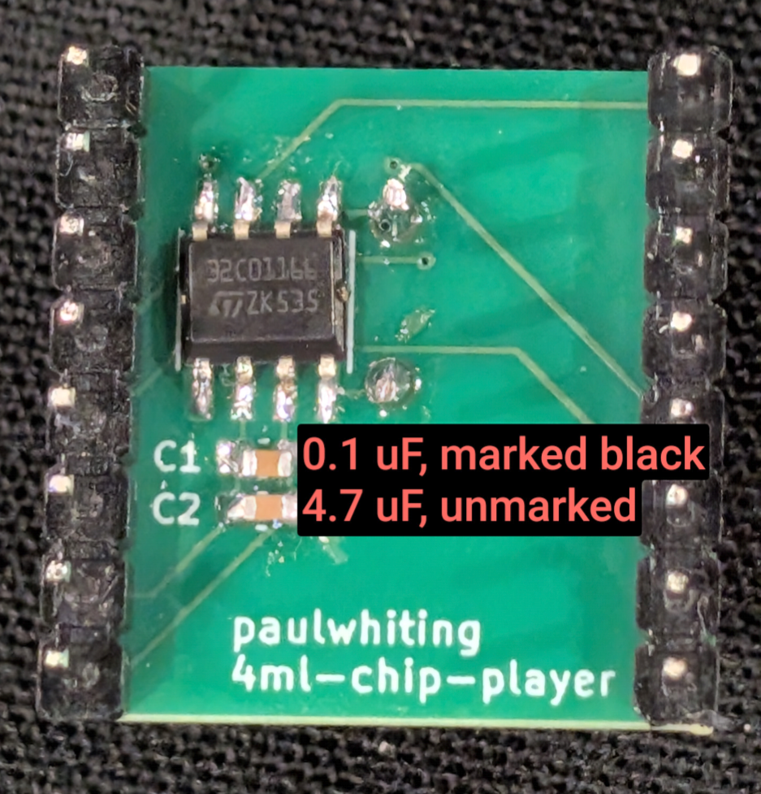

# 4ML Chip Player

This repository hosts the hardware specifications and software needed to create a 1-bit music [minibadge](https://github.com/lukejenkins/minibadge),
given out at SAINTCON 2026.


## Playlist

* Duck Tales - Moon Theme 
* Metroid - Kraid's Hideout
* Super Mario Bros - Overworld
* Super Mario Bros - Underground
* Super Mario Bros - Swimming
* Ninja Gaiden - Unbreakable Determination
* Wizards and Warriors - Intro
* Rad Racer - Tune 2
* Gauntlet - Intro
* Mega Man 3 - Proto Man (Whistler)
* Goonies 2 - Good Enough
* Kid Icarus - Stage 1 Underworld
* Mike Tyson's Punchut - Match
* Secret of Mana - Color of the Summer Sky
* Sorcerian - Where We Meet
* Wii Channels - Mii Channel
* The Legend of Zelda - Overworld
* Zelda II - The Adventure of Link - Temple
* The Legend of Zelda - A Link to the Past - Dark World Overworld
* Contra - Stage 1
* Super Mario Bros 2 - Credits
* Trojan - Credits
* Ninja Gaiden - A Hero's End
* Harry Potter - Hedwig's Theme
* BYU fight song
* Rick Astley - Never Give You Up


## Hardware

This minibadge uses the STM32C011J6M6 chip with the buzzer connected to pins 4 and 5 for differential drive.  This gets a bit more volume out of the buzzer than connecting one pin to ground.

The pinout is designed for flexibility in the event you want to tinker with the badge itself.  Currently the software uses bitbanging PA0 and PA8 outputs to drive the buzzer.  This could instead be updated to use the TIM1\_CH3 and its opposite TIM1\_CH3N outputs to have the buzzer be driven via the timer hardware itself.

```
STM32C011J6M6 Pinout 

1 - SDA (for I2C)
2 - 3v3
3 - Ground
4 - Buzzer (PA0 or TIM1_CH3)
5 - Buzzer (PA8 or TIM1_CH3N)
6 - Button
7 - Main badge clock / SWDIO (for flashing)
8 - SCL (for I2C) / SWCLK (for flashing)
```

Similarly, the chip is connected to the I2C and clock pins from the main badge.  These are currently unused, but you could in theory have the main badge control the minibadge to play a song via I2C command, or if you're running multiples of this music minibadge, perhaps they could be kept in sync with each other by using the main badge's clock signal.

```
Minibdge Pinout

1 - Not connected (NC)
2 - NC
3 - NC
4 - SWCLK
5 - SWDIO
6 - NC
7 - +3v3
8 - Ground

9  - CLK
10 - NC
11 - NC
12 - NC
13 - SCL
14 - SDA
15 - NC
16 - NC
```


### Assembling the minibadge

#### Components

The SAINTCON 2026 minibadge kit comes with:
* STM32C011J6M6 chip
* Buzzer
* Switch
* two capacitors
   - A 0.1 uF capacitor, marked with black.  This is to be soldered as C1, closest to the chip.
   - A 4.7 uF capacitor, unmarked.  This is to be soldered at C2.

#### Back component orientation



#### Soldering Steps

1. Solder the chip first, ensuring the correct orientation.  Pin 1 on the chip is the bottom left pin when the chip markings are readable.  I.e., 32C01166 and the ST logo should be right side up.  Pin 1 must be matched to the dot on the pcb indicating pin 1.  The chip is oriented such that it matches the printed text on the PCB.

2. Solder the capacitors next.

3. Solder the switch.

4. Solder the buzzer, followed by the header pins.  Note that if you need more room to solder header pins, the buzzer could be soldered on last.


## Software

The firmware itself started as a fork of [protodomemusic/super-waveexe](https://github.com/protodomemusic/super-wavexe).  Original prototyping was done using attiny and atmega chips, but the code was updated to support the STM32 pinout as described in the hardware section.  You'll see AVR influences throughout the codebase.

Improvements from the original codebase include: 
 - An updated 4ML compiler that can reduce compiled sizes by supporting variable-duration notes in the output rather than emitting multiple tied notes.
 - An additional script to shrink file sizes.
 - Bug fixes and improvements to the midi to 4ml script.


This project assumes `STM32_Programmer_CLI` is available on your path.

This poject uses `make` to automate calling scripts for you.


### General method to convert a song

1. Find a midi file for a song you like.  (e.g., song.mid)
2. Invoke `make song.4ml` to output the 4ML formatted version of the song.
   - This invokes `compiler/midi-2-4ml.py`
   - It tries to detect percussion channels
3. Edit the 4ML file (e.g., song.4ml).
   - The voices are split into different channels.  (e.g., C1, C2, C3, ....  Observe the C is capitalized)
   - If there are too many channels, then the song will run low and slow.  Reduce the number of channels and/or increase the playback speed.
     * You can invoke `make song.reduced.4ml` to pack the song data into the fewest channels possible.
     * Tempo is... backward right now.  It is global in scope, so when the player sees `txxx` (where `x` is a digit), it will play all channels at that new tempo.  Right now, the default tempo is "60", and thanks to being backward, smaller numbers mean faster.  If you import a song and it needs to be faster, then decrease the tempo number.  This can be done by prepending `C1 t50` to the 4ML file.

4. Lastly, flash the song to the chip with `make song.st`.

5. Create an album 


### Notes

* Use different `make` targets to transform your song:
  - `make song.reduced.4ml`   - Compact the notes into the fewest channels possible.
  - `make song.transpose12.4ml` - Transpose the song up or down the indicated number of steps.  Supports numbers from -24 to 24.
  - `make song.volume16.4ml`    - Set each note's volume to the value indicated.  Supports numbers from 1 to 16.
  - `make song.tempo35.4ml`     - Sets the song's tempo.  Supports numbers from 1 to 255.
  - `make song.min.4ml`         - Extract and use patterns from the song to save space.
  - `make song.st`              - Flash the song to the chip using an STLINK device.
  - `make song.pyocd`           - Flash the song to the chip using pyOCD for Flipper Dap Link.
  - `make song.reduced.transpose6.tempo35.volume16.min.st` - Compact the notes and shift them down 6 steps, set the tempo to 35 and the volume to 16 (loudest).  Then shrink the file using patterns and flash the chip.


### Bugs

* Due to how the player plays everything without a timer control, using `make song.reduced.4ml` may affect the song's pitch at certain points in the song as it takes longer or shorter to play a channel due to data processing differences from the original song..
* Sometimes when flashing the chip it acts as if there's a button press, which could either pause the playback or skip to the next song.  If in doubt, press the button to start playback as needed.
* Tempo is backward.  Lower numbers play faster.


## Flashing the minibadge

The minibadge comes pre-flashed with an album of music.  If you want to flash new music, you can either use an ST-LINK device with `make song.st` or if you have a flipper use `make song.pyocd` to flash with `pyOCD` on your computer and DAP Link on your flipper.

### WARNING

The minibadge only functions correctly when first flashed with `make song.st` so the option bytes are set correctly.  The `make song.pyocd` rule doesn't flash those bytes... yet.  After the initial flash, subsequent flashes can be done with the .pyocd rule.


## Future Work

* Use TIM.
* Make tempo function properly.
* Put together a whole bunch of these and control them via I2C.


## References

* https://phd.protodome.com
* https://github.com/protodomemusic/super-wavexe
* https://github.com/protodomemusic/mmml
* https://scruss.com/blog/2020/04/02/protodomes-wonderful-chiptunes-how-to-play-them-on-your-own-attiny85-chips/
* https://blog.coredump.cx/p/mcu-12-music-with-one-bit-to-spare
* https://github.com/lukejenkins/minibadge
